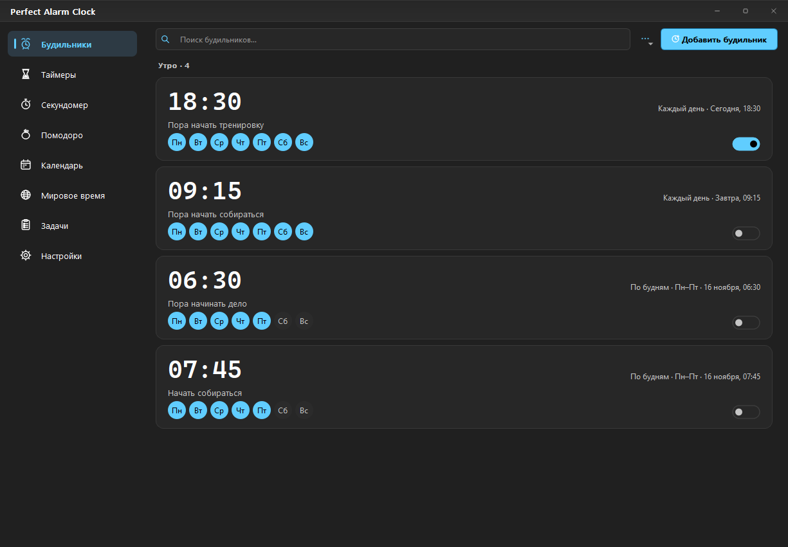
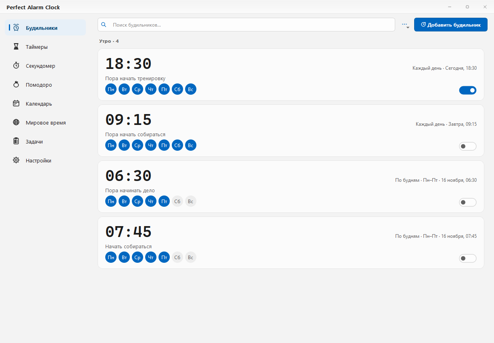
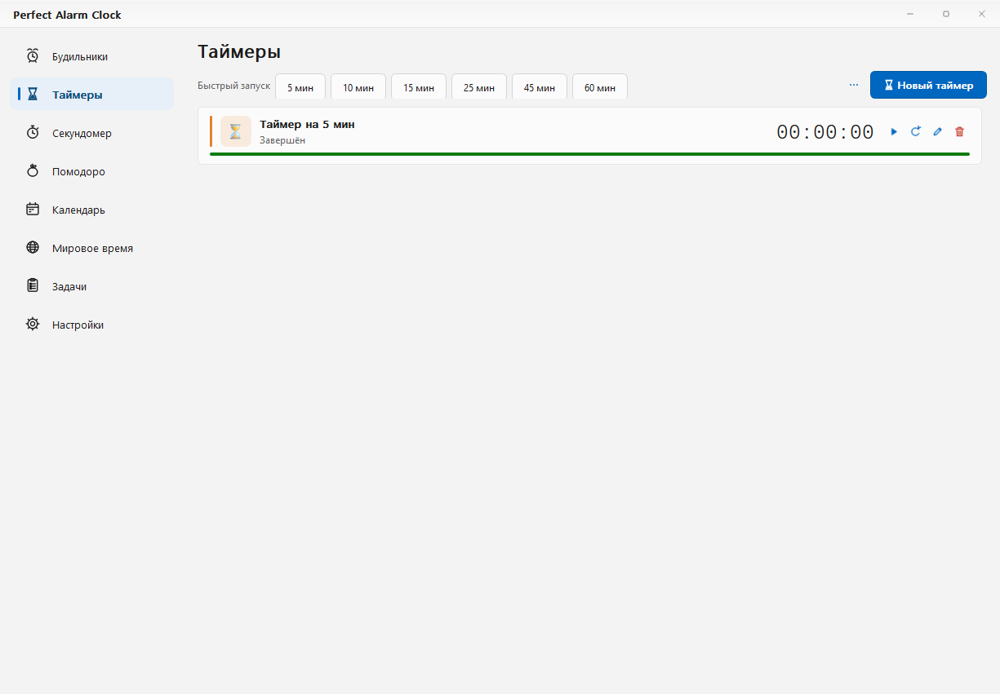
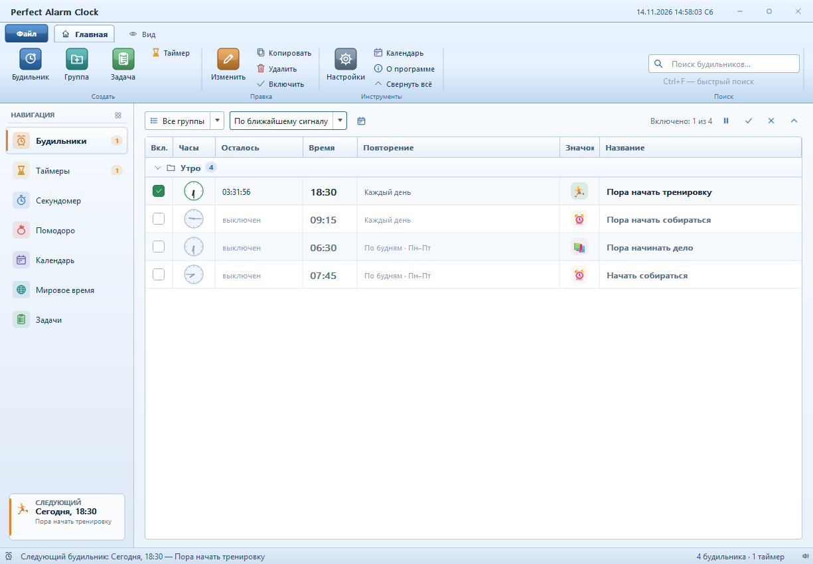

# Perfect Alarm Clock

Будильник для Windows в стиле Office и Windows 11 Clock: будильники, таймеры, секундомер, помодоро, календарь, мировое время и задачи в одном окне.



## Возможности

- **Будильники** — группы, повторы (каждый день, по будням, по выходным, выбранные дни, интервалы), откладывание, плавное нарастание громкости, свои звуки.
- **Таймеры** — несколько одновременно, быстрый запуск на 5–60 минут.
- **Секундомер** — круги и сброс; **помодоро** — циклы работы и отдыха.
- **Календарь** — несколько видов, будильники и задачи прямо в сетке; **мировое время** — часовые пояса; **задачи** — списки дел.
- **12 тем** — Office 2007/2010, Windows 8.1/10, праздничные и Windows Clock (светлая/тёмная).
- **Трей** — сворачивание в область уведомлений, режим «поверх всех окон».
- Окно свободно растягивается, интерфейс подстраивается под размер.

## Установка

1. Скачайте архив `PerfectAlarmClock-1.0.0.zip` со страницы [Releases](https://github.com/ZekiTRR/PerfectAlarmClock/releases).
2. Распакуйте в любую папку.
3. Запустите `PerfectAlarmClock.exe`.

Установка не требуется. Настройки хранятся в `%APPDATA%\PerfectAlarmClock`, данные — в `%LOCALAPPDATA%\PerfectAlarmClock`.

## Быстрый старт

### Будильники

Нажмите **«Добавить будильник»**, задайте время, повтор и звук. Переключатель на карточке (или галочка в таблице) включает будильник, двойной клик открывает редактор. Вкладка «Повтор» поддерживает дни недели, интервалы и исключения.



### Таймеры

Кнопки быстрого запуска или **«Новый таймер»**. Пробел — старт/пауза выбранного таймера.



### Секундомер и помодоро

Пробел — старт/пауза. В секундомере: `L` — круг, `R` — сброс. Помодоро сам чередует работу и отдых.

### Календарь, мировое время, задачи

Календарь показывает будильники и задачи в сетке месяца, недели, дня и года. Мировое время — часы выбранных поясов. Задачи — список дел с отметками выполнения.

## Темы

**Настройки → Оформление → Тема**: Office 2007/2010 (синяя, серебро, чёрная), Windows 8.1/10, Хэллоуин, Новый год, Windows Clock (светлая и тёмная). Темы Windows Clock переключают окно в компактный режим карточек, как в приложении «Часы» Windows 11.



## Звуки

В комплекте встроенные сигналы и пак `Cool Alarms` (50 звуков, лицензия CC0). Свои звуки: положите `.mp3` или `.wav` в папку `sounds` рядом с exe — они появятся в списке выбора звука.

## Горячие клавиши

| Клавиши | Действие |
| --- | --- |
| `Ctrl+N` | Новый будильник |
| `Ctrl+F` | Поиск |
| `Ctrl+,` | Настройки |
| `F1` | Справка |
| `Пробел` | Старт/пауза на странице таймеров, секундомера, помодоро |
| `Ctrl+Alt+D` | Выключить сработавший будильник |
| `L` / `R` | Круг / сброс секундомера |

В таблице будильников: `Пробел` — включить/выключить, `Enter` или `F2` — редактировать, `Ctrl+D` — дублировать, `Delete` — удалить, `Esc` — сбросить фильтр.

## Сборка из исходников

Нужны Windows 10/11, Qt 6 (MSVC 2022 x64), CMake и Ninja. Поправьте пути к Qt и Visual Studio в `build.bat` под свою систему и запустите его:

```
build.bat
```

Готовый exe появится в `build\PerfectAlarmClock.exe`. Для распространения скопируйте его в папку с Qt-библиотеками (`windeployqt`) и папкой `sounds`.

## Лицензии звуков

Пак `Cool Alarms` — BigSoundBank, лицензия CC0 (см. `sounds/Cool Alarms/LICENSE.txt` в архиве релиза).